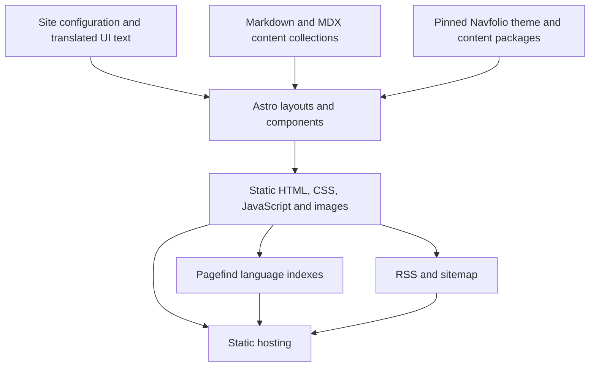

# Navfolio analysis and SWEBOK-informed portfolio plan

Original audit: 12 October 2026. Engineering-plan revision 3: 13 October 2026. Scope: source/live-site analysis and a SWEBOK-informed execution plan, incorporating Git version control, GitHub source publication, Docker locally and Cloudflare Workers Free hosting. No portfolio application has been built or published.

**Recommendation:** adapt Navfolio into a bilingual personal publishing site. Preserve its paper-like colors, typography, navigation, and reading experience. Make your projects and writing the main content, with your own identity and a simpler homepage. Validate the package-level bilingual changes through a bounded experiment before broad customization.

Your confirmed preferences are to publish projects and writing, retain Navfolio’s overall style while personalizing the details, and support English and Bahasa Indonesia. You also require Git version control with source published on GitHub, Docker for local execution, and Cloudflare Workers Free for hosting. Your public name, biography, project details, domain, GitHub repository destination, and actual articles have not yet been supplied. All proposed personal content below is a content requirement, not a claim about you.

**Hosting assessment:** the planned fully static portfolio is viable on Workers Free. Build and preview locally in Docker, then upload the generated files through Wrangler to Workers Static Assets. The [Docker/Cloudflare assessment](./docker-cloudflare-hosting.md) records current limits, feature fit, operating costs, proposed configuration and release checks. Source: [Cloudflare's static-asset billing](https://developers.cloudflare.com/workers/static-assets/billing-and-limitations/). Final artifact size, container behavior and the actual account remain execution checks.

## 0. Revised engineering approach

This revision uses the supplied **SWEBOK Guide v4.0a (cover: released August 2026)**. The [review and tailoring record](./swebok-review-and-tailoring.md) maps all 18 knowledge areas, selected passages read, printed/PDF page references, and practices appropriate to this project. It is a project-focused review, not a claim of a line-by-line reading of every page or of the external standards cited by the book.

The goal remains a useful personal home for writing and projects. SWEBOK strengthens how we define, build, verify, release and maintain it. Its introduction explicitly calls for project-specific Exselection of practices (printed xl / PDF 41); it does not require a large bureaucracy or confer product certification.

| Decision in this revision                    | Concrete artifact and effect                                                                                                                                                                                                        |
| -------------------------------------------- | ----------------------------------------------------------------------------------------------------------------------------------------------------------------------------------------------------------------------------------- |
| Separate needs from assumptions              | [Requirements and traceability](./requirements-and-traceability.md): three product goals and three execution/source/hosting constraints, 29 derived/proposed requirements, acceptance contracts, open decisions and work/test links |
| Recover understanding before changing source | Sections 1–5 retain the observed Navfolio baseline; implementation remains a separate activity. SWEBOK distinguishes passive reverse engineering from alteration/reengineering (7-13–7-14 / PDF 179–180)                            |
| Make architectural choices reviewable        | [Architecture and design](./architecture-and-design.md): boundaries, module contracts, ten decisions with proposed mechanisms, alternatives, publication rules and interaction states                                               |
| Resolve risky reuse early                    | B20 tests core Indonesian support, injected routes, real translation pairing and search as one small slice before all pages are personalized                                                                                        |
| Build quality throughout delivery            | [Quality and operations](./quality-and-operations.md): T01–T20, measurable proposed quality targets, manual/owner validation, 11 initial risks and evidence-based release gates                                                     |
| Control what is released                     | Pin source/content/tool inputs; preserve relevant notices; record the tested artifact; validate hosted output and rehearse rollback                                                                                                 |
| Publish maintainable source                  | Dedicated Git repository on GitHub, documented branch/commit workflow, reproducible public checkout, release tags and source-to-deployment traceability; see §11.1                                                                  |
| Plan the full product life                   | Authoring rehearsal, backup/restore, dependency/fork maintenance, ownership, costs and eventual migration/retirement are part of delivery                                                                                           |
| Expose uncertainty in effort                 | Replace the earlier estimate with a bottom-up range and contingency; re-estimate after the feasibility and bilingual milestones                                                                                                     |

Git/GitHub, Docker and Workers Free are confirmed owner constraints. Detailed implementation mechanisms and project quality targets remain **proposed** until validated in the appropriate delivery step; published platform limits are externally verified constraints. The current assignment is to revise the plan. Repository creation, commits/pushes, deployment, service purchases and application implementation remain future execution work. No recurring monitoring has been set up.

The original three planning documents are preserved in [the pre-SWEBOK archive](./archive/pre-swebok-2026-10-12/analysis-and-plan.md), and revision 1 is preserved in [the pre-Docker/Cloudflare archive](./archive/pre-docker-cloudflare-2026-10-13/analysis-and-plan.md). The screenshot/source evidence remains the original audit evidence; this revision does not expand those browser checks retroactively.

Revision 2 is preserved in [the pre-Git/GitHub archive](./archive/pre-git-github-2026-10-13/analysis-and-plan.md).

## 1. Evidence and confidence

The analysis uses the public [live site](https://astro.navfolio.site/), a local inspection of the complete main repository, its pinned theme dependency, and its documentation submodule. The source snapshot is [v1 at 70aa71ddd9f7ee4af38fa5810b320820712f1885](https://github.com/dodolalorc/astro-navfolio/tree/70aa71ddd9f7ee4af38fa5810b320820712f1885). The theme is pinned to [0be2d98](https://github.com/navfolio/theme-default/tree/0be2d98); the checked-out demo content is [cadc1bb275fced899b29692d1adb0cc7e1633861](https://github.com/navfolio/astro-navfolio-docs/tree/cadc1bb275fced899b29692d1adb0cc7e1633861). The deployment workflow can fetch a newer documentation commit, so that recorded submodule commit does not prove the exact deployed content revision.

An isolated Chrome session inspected all six main sections, one blog article, and one project detail page at 1440px. Home, Blog, article, and Projects were also inspected at 390px. Additional checks covered Home at 320px and 820px and an article at 900px. Fifteen page/viewport combinations were captured. Search, theme switching, and the mobile menu received interaction checks.

No document-level horizontal overflow was detected in those samples. The search shortcut opened and focused the input, a query returned six linked results, and Escape closed the dialog. Light-to-dark switching and opening the mobile navigation succeeded. No JavaScript exceptions were captured during those checks. Four remote Media covers did fail to render; that observation is recorded below and should not be obscured by the otherwise successful interaction checks.

Evidence is saved beside this document:

- [Desktop homepage](./evidence/home-desktop.png), [mobile homepage](./evidence/home-mobile.png), and [dark homepage](./evidence/home-dark.png).
- [Writing archive](./evidence/blog-desktop.png), [article](./evidence/article-desktop.png), and [projects](./evidence/projects-desktop.png).
- [Browser measurements](./evidence/browser-audit.json) and [additional checks](./evidence/browser-followup.json).

**Verification limits:** this is not a complete accessibility, security, or performance audit. The source was not installed or production-built locally. Browser checks used Chrome, without network throttling or assistive technology. Full-page scrolling, every content component, every taxonomy route, and third-party comment services were not comprehensively exercised. The deployed HTML identifies Astro 7.1.3, matching the inspected lockfile, but no deployed commit identifier was found.

## 2. What the reference site actually does

Navfolio combines a personal homepage with an archive of writing and project documentation. Its content is generated into static files; search runs in the browser against a generated index. The base experience needs no database, account system, or application server.

| Area           | Observed experience                                                                                                                         | Recommendation for your portfolio                                                                             |
| -------------- | ------------------------------------------------------------------------------------------------------------------------------------------- | ------------------------------------------------------------------------------------------------------------- |
| Home           | Large introduction and current activities on the left; profile, writing statistics, activity grid, shortcuts, and social links on the right | Preserve the two-column character; shorten the introduction and add real recent writing and selected projects |
| Blog           | Numbered article rows, pinned posts, metadata, categories, series, tags, year archive, and six articles per page                            | Keep the editorial list; use “Writing” / “Tulisan” as the navigation label                                    |
| Article        | Heading, date, reading time, tags, category/series links, body, desktop contents sidebar, mobile reading tools, and additional posts        | Reuse; localize metadata and improve related-content selection                                                |
| Projects       | Two-column project summaries with icons, description, date, authors, links, and tags                                                        | Keep the lightweight presentation; make project explanations and results more prominent                       |
| Project detail | An article-like case study rather than an elaborate gallery                                                                                 | Reuse for background, implementation choices, screenshots, lessons, and links                                 |
| Vibe           | Short dated notes with optional mood, location, images, and a decorative trail                                                              | Defer; reintroduce as “Notes” / “Catatan” if short-form publishing becomes useful                             |
| Media          | Books, films, and music grouped into shelves, with ratings and optional reviews                                                             | Defer until you have a real collection to publish                                                             |
| About          | Long-form biography/site description using the article layout                                                                               | Replace entirely with your biography, interests, and contact details                                          |
| Search         | Modal opened by button or Cmd/Ctrl+K, snippets and up to six results                                                                        | Retain; make index and labels language-aware                                                                  |
| Subscription   | RSS feed                                                                                                                                    | Retain, with separate English and Indonesian feeds                                                            |

The site contains capabilities that should not be mistaken for live integrations: the homepage activity grid is calculated from blog publication dates, not fetched from GitHub. “Recently” is a manually configured list. Comments are implemented but disabled in the inspected configuration. The demo’s résumé and social shortcuts include placeholder destinations. Sources: [homepage composition](https://github.com/dodolalorc/astro-navfolio/blob/70aa71ddd9f7ee4af38fa5810b320820712f1885/src/pages/index.astro), [activity calculation](https://github.com/dodolalorc/astro-navfolio/blob/70aa71ddd9f7ee4af38fa5810b320820712f1885/src/utils/blog-heatmap.ts), and [site configuration](https://github.com/dodolalorc/astro-navfolio/blob/70aa71ddd9f7ee4af38fa5810b320820712f1885/src/config/site.toml).

## 3. The visual system to preserve

The identity comes primarily from restrained typography, spacing, and color. Most homepage sections have transparent backgrounds and little framing. Replacing them with a dense grid of boxed cards would substantially change the design.

### Measured design tokens

| Token                  | Light mode                          | Dark mode / behavior                               |
| ---------------------- | ----------------------------------- | -------------------------------------------------- |
| Page background        | `#fdfdf9`                           | `#171b18`, with deeper green-black gradients       |
| Surface                | `#fffffc`                           | `#202620`                                          |
| Main ink               | `#272d28`                           | `#eaebe5`                                          |
| Secondary ink          | `#667066`                           | `#b5beb1`                                          |
| Faint ink              | `#90998f`                           | `#899487`                                          |
| Sage accent            | `#667d6d`                           | `#a8baa9`                                          |
| Main shell             | Maximum 1168px                      | Centered                                           |
| Typical desktop gutter | 32px                                | Mobile gutters vary by page, approximately 16–32px |
| Reading width token    | 760px                               | Article body also has its own width constraints    |
| Homepage columns       | Up to 760px + 286px                 | 42px gap                                           |
| Corners                | Commonly 8px                        | Light borders and very small shadows               |
| Article text           | 18px; line height 1.75              | Maintain comfortable reading width                 |
| Archive heading        | 64px at the inspected desktop width | Approximately 33px at 390px                        |

These values come from the [pinned theme CSS](https://github.com/navfolio/theme-default/blob/0be2d98/src/styles/global.css), [palette definitions](https://github.com/navfolio/theme-default/blob/0be2d98/src/styles/palettes.css), [article styles](https://github.com/navfolio/theme-default/blob/0be2d98/src/styles/blog-article.css), and the saved computed-style measurements.

The main Latin font is Maple Mono. The reference additionally uses ChillRoundM for Chinese and Monaco for code. Keep the Maple Mono character for the first implementation, then judge long English and Indonesian articles using real content. A separate reading font is an optional later design decision, not required to achieve the requested style.

The floating navigation is roughly 900px wide on the inspected desktop screen. It has a compact brand, active-section highlight, repository link, theme toggle, and search button. On small screens, the links move into a menu. Your version also needs a clear `EN / ID` language control, which requires a deliberate compact layout rather than squeezing one more item into the existing header.

### Responsive behavior

The homepage changes from two columns to one at 920px. At 820px and below it uses explicit visual ordering: profile, contact icons, navigation shortcuts, activity grid, introduction, then current activities. This puts the main introduction below the first mobile screen. Articles lose their desktop sidebar at 900px; the navigation and project grid have additional changes around 720px. These are distinct layout decisions, not a single universal breakpoint. Sources: [homepage layout](https://github.com/dodolalorc/astro-navfolio/blob/70aa71ddd9f7ee4af38fa5810b320820712f1885/src/components/layout/DashboardFlow.astro), [article CSS](https://github.com/navfolio/theme-default/blob/0be2d98/src/styles/blog-article.css).

For your mobile homepage, use this order: compact identity and introduction → recent writing → selected projects → current focus → RSS and contact links. Keep the activity grid lower down, or omit it initially when there is little publication history. Implement a sensible DOM reading order as well as visual ordering, so keyboard and assistive-technology users follow the same story.

Keep hover changes and page transitions subtle. Retain reduced-motion support. Raise contrast for small metadata and preserve conspicuous keyboard focus. The reference’s faint ink on its light background computes to about 2.88:1; it should not carry essential small text unchanged. The sage accent computes to about 4.36:1 on the same background, so text uses also need contrast review. These are token-pair calculations, not a verdict on every rendered element.

## 4. Source architecture and ownership

The current repository is more modular than its README suggests. The README still names Astro 6, while both the live page metadata and locked dependency identify Astro 7.1.3. Use the source manifest and lockfile as the baseline. The project requires Node 22.12 or newer, uses Bun scripts and a Bun lockfile, and declares Tailwind 4.3.3, Pagefind 1.5.2, MDX, RSS, sitemap, Expressive Code, Lucide icons, and Sharp. Source: [package manifest](https://github.com/dodolalorc/astro-navfolio/blob/70aa71ddd9f7ee4af38fa5810b320820712f1885/package.json).



| Responsibility                                                     | Current owner                                                               | Adaptation approach                                                                                |
| ------------------------------------------------------------------ | --------------------------------------------------------------------------- | -------------------------------------------------------------------------------------------------- |
| Identity, navigation, home copy, themes, comments, search settings | `src/config/site.toml`                                                      | Replace brand and placeholder values; introduce localized copy without duplicating shared identity |
| Content schemas                                                    | `src/content.config.ts`                                                     | Add language and translation identity; extend project metadata only when the interface uses it     |
| Homepage composition                                               | `src/pages/index.astro`, cards, widgets, `DashboardFlow.astro`              | Reuse and rearrange; introduce recent-writing and selected-project components                      |
| Blog listing and taxonomy                                          | `src/pages/blog/**`, `src/pages/tags/**`, blog components                   | Add locale filtering and shared localized URL construction                                         |
| Article layout                                                     | `src/layouts/BlogArticle.astro`                                             | Pass locale explicitly; update metadata, related items, feeds, and translation links               |
| Projects                                                           | Main repository’s `src/modules/routes/**`, registered by module integration | Add locale-aware route generation without duplicate unprefixed routes                              |
| Global design and base head/layout                                 | External `@navfolio/theme-default` package, with local wrappers             | Reuse pinned version; use controlled local overrides or a documented fork for changes it owns      |
| Vibe and Media routes/UI                                           | External page packages through `@navfolio/pages`                            | Disable for the first release; inspect their locale contracts before adding them                   |
| Markdown extensions                                                | `@navfolio/plugin-markdown` and companion packages                          | Keep syntax/code support; enable math and diagrams when the content needs them                     |
| MDX content widgets                                                | `@navfolio/mdx-components`                                                  | Import only components used by your content                                                        |
| Search behavior                                                    | `src/utils/site-search.ts`                                                  | Retain modal behavior; adapt paths, language state, and indexing scope                             |
| Locale normalization                                               | External `@navfolio/core` and the host’s `src/utils/ui-text.ts`             | Add explicit Indonesian support in the actual normalization/translation path                       |
| Build and deployment                                               | Build scripts, `astro.config.mjs`, workflow, `vercel.json`                  | Convert demo publication into your personal-content workflow                                       |

There are five direct `@navfolio/*` GitHub dependencies and further transitive packages. Their locked commit identities matter. Keep the lockfile, install it without refreshing versions, and update deliberately. Editing `node_modules` would be lost on reinstall. Sources: [lockfile](https://github.com/dodolalorc/astro-navfolio/blob/70aa71ddd9f7ee4af38fa5810b320820712f1885/bun.lock), [module registration](https://github.com/dodolalorc/astro-navfolio/blob/70aa71ddd9f7ee4af38fa5810b320820712f1885/navfolio.config.ts), and [route integration](https://github.com/dodolalorc/astro-navfolio/blob/70aa71ddd9f7ee4af38fa5810b320820712f1885/src/plugins/config.ts).

**Reuse decision:** fork or instantiate the template at the recorded revision, preserve its MIT copyright/license notice, and maintain your content and narrowly scoped changes in your own repository. Replace the author’s branding and demo assets. A clean-room rewrite is not currently justified by the publishing goal; a simpler Astro implementation remains a fallback if the bounded localization experiment shows that maintaining the inherited packages would be disproportionately costly. A wholesale React/Next.js migration is also unnecessary for this scope. The source’s reuse terms are in its [MIT license](https://github.com/dodolalorc/astro-navfolio/blob/70aa71ddd9f7ee4af38fa5810b320820712f1885/LICENSE); bundled fonts and externally hosted media should be considered separately when selecting retained assets.

## 5. Findings that affect implementation

| Priority                | Finding and evidence                                                                                                                                        | Planned response                                                                                                                           |
| ----------------------- | ----------------------------------------------------------------------------------------------------------------------------------------------------------- | ------------------------------------------------------------------------------------------------------------------------------------------ |
| Launch blocker          | The inspected main tree has no `src/content` entries. About throws if its entry is missing; Projects throws if its index entry is missing                   | Create personal About and project-index content before expecting a personal-mode build to succeed                                          |
| Launch blocker          | GitHub Pages and Vercel configuration build the docs mode; the Pages workflow hard-codes `astro.navfolio.site` and pulls the docs submodule with `--remote` | Build personal content, set your canonical URL/base, and remove the dependency on upstream demo updates                                    |
| Required for your scope | UI dictionaries currently support `en`, `zh-CN`, and `zh-TW`; a single global setting supplies the page language                                            | Add Indonesian UI and a per-page locale model, plus localized routes and content selection                                                 |
| Required for your scope | Pinned `@navfolio/core` recognizes only English/Chinese locale aliases and maps `id` back to English                                                        | Extend the core locale support in a controlled, pinned dependency change; adding `id.json` alone is insufficient                           |
| Required for your scope | `pagefind.yml` sets `force_language: zh`, overriding automatic language separation                                                                          | Remove the forced language, rebuild the index, and verify separate English/Indonesian results                                              |
| Required for your scope | Blog links, taxonomies, feeds, heatmap links, search type detection, and module routes assume unprefixed paths                                              | Centralize URL creation and migrate every consumer together                                                                                |
| High                    | Global styles and several components live in external GitHub packages                                                                                       | Record which changes are local overrides and which need a pinned package fork                                                              |
| High                    | Inspected pages use the same `fail-loading-image` asset for social previews; the article layout does not pass its hero image to BaseHead                    | Add a branded default sharing image and pass per-article/project images to metadata                                                        |
| High                    | `favicon.svg` is 939,801 bytes in the repository; Chrome recorded roughly 712KB transferred for it on the initial visit                                     | Replace it with a small identity icon and regenerate favicon/manifest assets                                                               |
| Medium                  | The Chinese font pipeline needs Python, FontTools, and Brotli; bundled full fonts include roughly 6.5MB and 25.6MB files                                    | For an English/Indonesian site, remove unused CJK loading, prefetch, and subsetting coherently; keep only required font weights            |
| Medium                  | Four remote media covers failed to render in the captured Media page                                                                                        | If Media is added, use reliable permitted assets and a clean fallback; the browser observation does not establish the remote failure cause |
| Medium                  | Small metadata uses faint colors; mobile icon controls measure roughly 34–36px                                                                              | Review contrast, enlarge touch targets where practical, and test keyboard/focus behavior                                                   |
| Medium                  | “Related posts” currently selects the latest other blog entries, irrespective of topic                                                                      | Filter by language and rank by shared subject/series; fall back to recent writing                                                          |
| Medium                  | Date handling and the activity grid depend on build-time dates; draft filtering alone does not implement future scheduling                                  | Set an explicit publication-date policy and consistent time zone; add scheduled rebuilds only if scheduled publishing is required          |
| Low                     | Sample social links, author details, Chinese copy, and résumé shortcuts are distributed across configuration and assets                                     | Audit all generated pages for demo identity before release                                                                                 |

Source details: [About requirement](https://github.com/dodolalorc/astro-navfolio/blob/70aa71ddd9f7ee4af38fa5810b320820712f1885/src/pages/about.astro), [Projects requirement](https://github.com/dodolalorc/astro-navfolio/blob/70aa71ddd9f7ee4af38fa5810b320820712f1885/src/modules/routes/projects-index.astro), [Pages workflow](https://github.com/dodolalorc/astro-navfolio/blob/70aa71ddd9f7ee4af38fa5810b320820712f1885/.github/workflows/deploy-pages.yml), [Vercel configuration](https://github.com/dodolalorc/astro-navfolio/blob/70aa71ddd9f7ee4af38fa5810b320820712f1885/vercel.json), [article layout](https://github.com/dodolalorc/astro-navfolio/blob/70aa71ddd9f7ee4af38fa5810b320820712f1885/src/layouts/BlogArticle.astro), [font build script](https://github.com/dodolalorc/astro-navfolio/blob/70aa71ddd9f7ee4af38fa5810b320820712f1885/scripts/fonts/subset-ui-font.ts), [core locale normalization](https://github.com/navfolio/core/blob/1e7954f/src/index.ts), and [Pagefind configuration](https://github.com/dodolalorc/astro-navfolio/blob/70aa71ddd9f7ee4af38fa5810b320820712f1885/pagefind.yml).

These are changes to plan, not changes already applied. The missing-content build blockers are inferred directly from checked-in files and explicit throw conditions; they were not reproduced in a local build.

## 6. Proposed portfolio structure

Launch with four primary sections: **Home, Writing, Projects, About**. Use `Beranda, Tulisan, Proyek, Tentang` in Indonesian. Keep RSS, GitHub, email, language selection, theme, and search as supporting controls. Keep technical route segments consistent between locales for maintainability; visible labels can differ.

| Page            | English route                                                   | Indonesian route       | Purpose                                       |
| --------------- | --------------------------------------------------------------- | ---------------------- | --------------------------------------------- |
| Home            | `/en/`                                                          | `/id/`                 | Introduce you and surface current work        |
| Writing         | `/en/blog/`                                                     | `/id/blog/`            | Browse articles and technical notes           |
| Article         | `/en/blog/<slug>/`                                              | `/id/blog/<slug>/`     | Read a published piece in its actual language |
| Projects        | `/en/projects/`                                                 | `/id/projects/`        | Browse selected and ongoing work              |
| Project detail  | `/en/projects/<slug>/`                                          | `/id/projects/<slug>/` | Understand a project and its implementation   |
| About           | `/en/about/`                                                    | `/id/about/`           | Biography, interests, principles, and contact |
| RSS             | `/en/rss.xml`                                                   | `/id/rss.xml`          | Subscribe in a chosen language                |
| Browse by topic | Locale-prefixed categories, tags, series, years, and pagination | Same structure         | Keep publishing archives useful as they grow  |

Use English as the provisional default for the root URL. On Workers Static Assets, implement the selected root redirect using a native `_redirects` rule, provisionally `/ /en/ 302`, and keep an Indonesian option on the destination. Verify this with local Wrangler and on the deployed site. This needs no custom Worker function. See [Cloudflare redirects](https://developers.cloudflare.com/workers/static-assets/redirects/).

### Homepage content proposal

On desktop, retain the broad editorial column and narrow identity column. The main column contains a short introduction, three recent articles, two selected projects, and a brief current-focus list. The side column contains your avatar/name, a one-sentence description, compact links, RSS, and an optional writing-activity grid. On mobile, collapse these into the content-first order described above.

This is the central product change: visitors should be able to open a real piece of writing or a real project immediately. The profile and statistics support that journey. No invented experience, project outcomes, testimonials, or activity counts should enter the live site.

A project detail should answer: what problem it addresses; who it is for; what you contributed; how it works; major decisions and tradeoffs; current status; outcomes that can be substantiated; what you learned; and where to see the demo or source. Screenshots should show meaningful behavior rather than serve as decoration.

## 7. English and Bahasa Indonesia implementation

This is a site-wide feature, not a replacement of `lang = "en"` with `lang = "id"`. The existing language setting changes one site-wide UI; it does not create parallel translated publications.

Use Astro’s locale support for `en` and `id`, prefix both locales, and share page components. Generate both route sets during the static build. Astro provides locale configuration and URL helpers, but the actual localized pages and content still need implementation. [Astro internationalization documentation](https://docs.astro.build/en/guides/internationalization/).

Recommended rules:

1. Translate all shared UI: navigation, search states, counts, dates, reading-time labels, pagination, theme controls, image controls, empty states, accessibility labels, and footer. Extend the pinned core’s locale aliases to accept `id`/`id-ID` through a documented dependency fork or an upstream-supported pinned revision; its current `createI18n` normalizes unknown languages to English.
2. Treat language as explicit page/content data. Pass it into UI helpers and layouts; do not mutate one global configuration object while generating two locales.
3. Add `lang: en | id`, `translationKey`, and an optional explicit slug to content schemas. Pair translations using `translationKey`, independent of their filenames or translated titles. Validate uniqueness per language.
4. Generate only real published translations. An untranslated article remains available in its original language. Do not silently reproduce English text under an Indonesian canonical URL.
5. A content translation link opens the matching translation. When none exists, state that clearly and offer the other language’s archive as a separately labeled action.
6. Filter archives, counts, related posts, series navigation, feeds, and homepage selections by language. A separate “other language” discovery link can expose original-only work without mislabeling it.
7. Use the correct document `lang`, self-canonical URL, and reciprocal `hreflang` links for translations that actually exist. Localize titles and descriptions too.
8. Use consistent category/tag identifiers and localized display names if topics should correspond across languages. Do not assume two differently spelled translated tags are the same entity.
9. Keep the language switch as ordinary links with a full page navigation initially. This avoids preserving stale language state in the current cached search module across an Astro client transition.
10. Adapt the Projects route injector explicitly. Registering the same page module twice is not an established solution; its current module-resolution and route-collision rules need to be respected.

Pagefind creates separate indexes using the HTML `lang` attribute and chooses the corresponding index in the browser. Its documentation lists support for Indonesian and English. First remove the repository’s `force_language: zh` override, which otherwise prevents the proposed language separation. Retain the custom search interface, translate its labels, and test representative phrases in both languages. Index article/project detail content preferentially so archives and tag pages do not crowd out the useful results, as they did in the observed generic search. [Pagefind multilingual search](https://pagefind.app/docs/multilingual/).

Create separate locale feeds with locale-specific links and metadata. If a default feed is retained, English is the provisional proposal; a combined feed is deferred unless a publishing need justifies it. Astro’s RSS integration can emit feeds from content collections. [Astro RSS guidance](https://docs.astro.build/en/recipes/rss/).

## 8. Content and authoring model

Continue authoring in Markdown; use MDX only when an article needs interactive or composed elements. Store personal writing with the site so a commit captures both content and the implementation used to publish it. Retain the upstream docs separately as reference, not as the portfolio’s publishing source.

Proposed content organization:

```text
src/content/
  about/en.mdx
  about/id.mdx
  blog/en/<slug>.md
  blog/id/<slug>.md
  projects/en/index.mdx
  projects/id/index.mdx
  projects/en/<slug>.mdx
  projects/id/<slug>.mdx
src/i18n/
  en.json
  id.json
```

This is a proposed structure. The existing About loader only matches a root `about.md` or `about.mdx`, and the existing project index checks `id === 'index'`. Both must change to select entries by locale. Merely creating these folders will not make bilingual pages work.

| Model   | Existing usable fields                                                                                             | Proposed additions                                                                         |
| ------- | ------------------------------------------------------------------------------------------------------------------ | ------------------------------------------------------------------------------------------ |
| Blog    | Title, description, date, draft, sticky priority, hero image, tags, categories, series, comments, sidebar controls | `lang`, `translationKey`, explicit slug if needed, optional updated date                   |
| Project | Shared article fields plus icon, icon color, authors, typed external links                                         | `lang`, `translationKey`, project status, role, stack, and featured selection if displayed |
| About   | Shared article fields                                                                                              | Locale selection; simplify date/reading metadata in the visible biography                  |

Source: [actual collection schemas](https://github.com/dodolalorc/astro-navfolio/blob/70aa71ddd9f7ee4af38fa5810b320820712f1885/src/content.config.ts). Project status/role/stack are proposals, not existing fields.

The publishing workflow should be: create a draft → write and add media → preview → validate metadata and links → publish through a reviewed commit → build → index search → deploy. Drafts must be absent from pages, listings, related posts, RSS, sitemap, and search. Test this with a uniquely searchable draft phrase. The proposed future-date policy is explicit: exclude entries dated after the recorded build date in Asia/Jakarta. They become eligible on a later build; no automatic scheduling is included. R11/R12/R28 and ADR04 define the shared predicate and date semantics.

For launch, aim for two substantive project pages and three articles, with translated Home and About pages. It is acceptable for some articles to be available only in one language. These are suggested content quantities, not a requirement to invent filler. The proposed acceptance floor is one real project and one real article, with localized Home/About and an honest empty state wherever a language has no publications.

## 9. Delivery sequence and effort

Follow the [updated backlog](./implementation-backlog.md). B01–B19 are retained, with B00 for the requirements baseline, B20 for the reuse experiment, B21 for security/supply-chain work, and B22 for authoring/maintenance handover.

| Stage                                      | Deliverable and evidence gate                                                                                                                                                                        | Remaining focused effort                                |
| ------------------------------------------ | ---------------------------------------------------------------------------------------------------------------------------------------------------------------------------------------------------- | ------------------------------------------------------- |
| Planning · G0                              | Coherent proposed requirements, architecture, test/risk strategy and backlog; this revision supplies the document package                                                                            | Already performed in this planning task; excluded below |
| Baseline · G1                              | Dedicated Git repository and upstream provenance; pinned Docker/source/tool inputs, minimal personal-mode fixture build and local Workers preview, bilingual experiment and documented fork decision | 8–14 hours                                              |
| Personal foundation                        | Personal content/build inputs, identity configuration, reduced feature set and publication boundary                                                                                                  | 4–6 hours                                               |
| Bilingual foundation · G2                  | EN/ID vertical slice, routes, selection, translation/fallback, metadata, search, feeds and date/draft tests                                                                                          | 12–20 hours                                             |
| Personal presentation · G3                 | Real content, homepage, project detail, long-form reading, assets and initial quality/owner review                                                                                                   | 8–12 hours                                              |
| Release readiness · G4; later release · G5 | Required evidence, Git/Docker author rehearsal, reviewed GitHub source, tagged artifact, preview/restore drill, source/site publication and handover within execution scope                          | 10–16 hours                                             |

**Revised base estimate: 42–68 focused hours, plus 9–14 hours of planning allowance; total envelope 51–82 hours.** This adds 2–4 baseline hours for Docker/local Workers verification to revision 1's 40–64-hour base; Workers deployment replaces its generic hosting work. It is an uncalibrated bottom-up judgment range, not a fixed calendar schedule or a statistical confidence interval. It includes technical tests/review within each increment, release rehearsal and handover. It excludes this completed research revision, owner writing/translation, new photography/illustration, service fees and waiting for external decisions/DNS.

The estimate assumes a small sustainable package fork and available owner content. A larger localization redesign or additional features requires re-estimation. Review actual effort and remaining uncertainty at G1 and G2. Workers Free is the hosting constraint; the proposed static architecture needs no paid Cloudflare add-on. Domain/backup/license fees and ongoing maintenance time remain separate costs; no budget for these or fixed deadline has been supplied.

Revision 3 keeps this estimate: basic Git/GitHub setup, source review and tagging are specified within the existing baseline/release work. Optional automated GitHub builds or deployments require a separate estimate if later requested.

Critical path: prove baseline and reuse → establish personal content and locale contracts → generate consistent public routes/content → integrate search/feeds/metadata → validate real content and reading → identify/test/recover the release artifact → publish when authorized. Content/asset preparation can progress alongside technical foundation work. Quality work accompanies every increment; it is not postponed until the final row.

## 10. Quality, validation and release criteria

The authoritative [quality and operations plan](./quality-and-operations.md) defines tests, environments, targets, risk responses, configuration control, defects, release and recovery. Its 20 test specifications cover:

- Clean builds, correct personal inputs and controlled dependencies.
- Locale normalization, uniqueness, routes, translations, publication eligibility, dates, archives and counts.
- Search loading/error/stale-state behavior, feeds, canonicals, alternate links, sitemap and sharing assets.
- Reading/layout, interaction lifecycle, accessibility, performance and source/build/output security.
- Owner content/value acceptance, publishing rehearsal, identified deployment and recovery.

Release evidence must identify the tested commit, configuration, build date, tool/browser versions, actual results and artifact. A missing test environment or unexecuted owner review stays explicitly pending. Source-inferred defects in the reference remain distinguished from reproduced failures.

Quality targets include WCAG 2.2 AA evaluation, zero generated internal-link/collision errors, zero unpublished-content leakage, and controlled representative lab measurements of LCP ≤2.5s and CLS ≤0.1. These are proposed project criteria. The quality plan gives the measurement profile, asset budgets, scope and limitations; a lab score does not establish field performance or full accessibility conformance. External references: [W3C WCAG 2.2](https://www.w3.org/TR/WCAG22/) and [Web Vitals](https://web.dev/articles/vitals).

Verification asks whether implementation satisfies its specification; validation asks whether the resulting site serves your actual publishing and reading needs. Both are necessary (SWEBOK 12-12 / PDF 257). Owner review therefore covers biography, project claims, translation voice, visual character and the ability to publish, alongside technical checks.

A gate is a short evidence review, not a request for approval at every routine step. Publication is a distinct action: in the later build scope, prepare the concrete preview and release record before any permission that is actually needed. This task stops at updated planning documents.

## 11. Operations and maintenance are delivery responsibilities

Use portable static output hosted by Cloudflare Workers Static Assets on Workers Free. Docker runs local editing, production builds and deployment previews; a distinct Wrangler step uploads the reviewed artifact. Use root base `/` and the chosen workers.dev/custom-domain origin. Keep no Worker entry point or SSR adapter in the initial deployment. Follow the [hosting assessment](./docker-cloudflare-hosting.md) for file limits, configuration, native redirects/headers, true 404s, credentials and plan verification. Upstream's GitHub Pages workflow is reference evidence, not the personal deployment target.

Before launch, rehearse restoring a known-good artifact in preview and rebuilding from backed-up source/content/assets/configuration. Hand over a short author guide, fork/dependency inventory, release/rollback instructions, maintenance checklist and unresolved debt list. Proposed recovery objective: restore within 30 minutes of starting the drill; this is not an around-the-clock response promise.

Every release records its identity and smoke checks. Proposed ongoing work includes monthly dependency/link/build reviews and quarterly or change-triggered restore checks. These are future operator responsibilities, not automations created during planning. Classify fixes, preventive work, environment adaptations, new features and improvements separately so maintenance cost and priorities remain visible.

### 11.1. Git version control and GitHub source publication

Maintain the portfolio in its own Git repository, with GitHub as the shared source destination. Plan for a public source repository to fulfill the publication goal; resolve the owner/organization and repository name before the first push. The repository boundary is the portfolio project, not the surrounding Sibsys workspace or the supplied research library. Git stores version history; Docker runs/builds the project; Cloudflare serves the generated website.

| Area                     | Proposed execution policy                                                                                                                                                                                                                                                                                                              |
| ------------------------ | -------------------------------------------------------------------------------------------------------------------------------------------------------------------------------------------------------------------------------------------------------------------------------------------------------------------------------------- |
| Upstream provenance      | Retain Navfolio's required notices and record the audited starting SHA. Preserve upstream history when using a fork/clone; use `origin` for the owner's repository and `upstream` for the reference when appropriate. Document any separate pinned core/theme forks and make required build dependencies accessible to source readers. |
| Tracked source           | Application code, publication-ready EN/ID content and permitted assets, schemas, lockfile, Docker/Compose/Wrangler configuration, tests, README, selected engineering documents and a change log. Commit a sanitized environment example if configuration needs one.                                                                   |
| Local/generated material | Ignore dependencies, generated `dist`, caches, logs, local environment secrets and credentials. Keep private drafts, the supplied book and unrelated research outside the public repository. Retain build artifacts separately for recovery.                                                                                           |
| Day-to-day changes       | Keep `main` usable; create short feature/fix/content branches, make small descriptive commits, run relevant Docker checks, review the diff in a pull request, then merge. A solo maintainer can perform the review; a second reviewer is not assumed. Link work items/requirements where useful.                                       |
| Published history        | Preserve shared history. Correct ordinary mistakes with follow-up or revert commits; do not routinely force-push `main` or move a published version tag. Fetch and review upstream changes on a separate branch before accepting them.                                                                                                 |
| Releases                 | Use annotated version tags, proposed starting label `v0.1.0`, for accepted release commits. Record GitHub repository URL, commit SHA, tag, build inputs, artifact checksum and Cloudflare deployment identity together. Publish concise GitHub release notes describing changes and known limitations.                                 |
| Handover                 | README covers cloning, Docker startup/build/preview, content/translation editing, relevant checks, explicit Cloudflare deployment and recovery. Verify a fresh checkout can build without the maintainer's local-only files or credentials.                                                                                            |

The branch/review sequence follows [GitHub flow](https://docs.github.com/en/get-started/using-github/github-flow). Release notes accompany a tag identifying a source revision; see [GitHub releases](https://docs.github.com/en/repositories/releasing-projects-on-github/about-releases). These are project practices supporting SWEBOK configuration management, not claims that SWEBOK mandates GitHub or a particular branching model.

Before source publication, review all commits and branches/tags being pushed for unintended private material, credentials and asset provenance. A website's `draft` flag does not hide files committed to a public repository. Ignore rules do not remove previously tracked files or erase history; see [GitHub's ignore-file guidance](https://docs.github.com/en/get-started/getting-started-with-git/ignoring-files). Keep original writing/media permissions documented separately from inherited code notices.

Review inherited GitHub workflows before the first push and remove or disable upstream demo synchronization/deployment jobs from the personal publication path. This ensures the initial source push follows the intended publishing workflow.

Delivery sequence: **branch and commit → Docker checks and review → merge/push source → identify and tag the release commit → build/verify its static artifact → explicitly deploy through Wrangler → verify and record the hosted release**. Each release build uses a clean checkout of the identified commit and recorded build date/origin. A GitHub push publishes source but does not trigger a Cloudflare deployment in the initial workflow. GitHub Actions checks and automatic deployments are optional later extensions; no account-plan-dependent repository rule is assumed necessary for the initial process.

Acceptance is traceable as UG06 → R29 → ADR10 → B01/B19/B21/B22 → T01/T15/T18/T19. Source publication should be completed by G5; the repository destination and public-content boundary are resolved before the first push. All of this remains planned in the current task.

## 12. Decisions and inputs still needed

The [requirements record](./requirements-and-traceability.md) lists O01–O08 with the milestone at which each matters. The [content brief](./content-brief.md) collects your public identity, material and language preferences.

English-default routing, Jakarta calendar-date publication, the minimal release-content quantity, green-soft/Maple Mono details, the domain/account/project identity, GitHub owner/repository name, review device availability and ongoing ownership are proposed or unresolved details. English/Indonesian support, publishing projects/writing, keeping Navfolio's overall style, Git version control and GitHub source publication, Docker locally and Workers Free hosting are confirmed goals/constraints.

The first implementation milestone, when execution is requested, is the pinned-source and bilingual feasibility experiment. Its result determines whether the planned narrow Navfolio adaptation remains the best route. The project is not ready to claim a mature shipped product until the acceptance and operational evidence exists.
