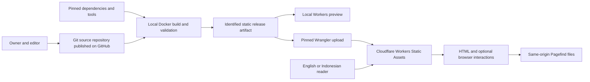

# Portfolio architecture and design decisions

Revision 3 · 13 October 2026 · Git/GitHub source management added; no application changes have been made.

The [original audit in the master plan](./analysis-and-plan.md) describes the observed system and its source ownership. This document describes the intended adaptation. Source principles: SWEBOK Ch. 2, printed 2-3–2-10; Ch. 3, 3-4, 3-6, 3-12–3-13; Ch. 4, 4-4, 4-8, 4-12; Ch. 11, 11-3–11-6. See [reading scope](./swebok-review-and-tailoring.md).

## Drivers and system boundary

The architecture must support publishing and reading, retain Navfolio's character, and treat English/Indonesian as actual content languages. The owner now requires Docker for local execution and Cloudflare Workers Free for hosting. Fully static delivery through Workers Static Assets is the proposed mechanism. Other constraints are package-owned layouts/routing, incomplete upstream Indonesian support, and a single maintainer's workload. The [hosting assessment](./docker-cloudflare-hosting.md) records verified platform allowances and remaining execution checks.

Inside the maintained system: personal source/content/assets, schemas, locale and publication rules, UI adapters, the build/search pipeline, tests, release configuration and documentation. External dependencies: source/dependency hosts, build runner, static host/CDN, DNS/domain provider, browser, and destinations of intentional external links. No visitor account, write API or database is planned.



The diagram shows data/deployment relationships, not an already running service. Repository permissions govern draft source access; excluding a draft from generated output does not make a public repository private. Build dependencies can execute code and are a separate trust boundary from passive visitor requests.

## Module and data view

| Responsibility                    | Intended interface                                                                              | Main consumers                                                |
| --------------------------------- | ----------------------------------------------------------------------------------------------- | ------------------------------------------------------------- |
| Locale normalization and messages | Validated `en`/`id`; supported aliases normalized once; complete required message keys          | Routes, layouts, controls, metadata                           |
| Content validation                | Validated entries with collection, language, stable translation key, slug, date and draft state | Publication selector, author diagnostics                      |
| Publication selection             | Eligible entries for an explicit locale and fixed build date                                    | Every list, detail route, feed, search source and sitemap     |
| URL construction                  | Canonical public path from base, locale, route kind, slug/page/taxonomy                         | Navigation, Projects injection, feeds, metadata, related work |
| Translation lookup                | Zero or one eligible counterpart per target locale                                              | Language switch, alternate links                              |
| Presentation                      | Shared templates receive locale and already selected content                                    | Home, Writing, Projects, About                                |
| Interaction lifecycle             | Initialize and dispose state per rendered page/locale                                           | Search, theme, menu, contents tools                           |
| Release assembly                  | Complete rendered output plus Pagefind and release manifest                                     | Preview, production, recovery                                 |

Keep these interfaces centralized and small. Do not scatter checks such as `if lang === 'id'` or duplicate draft filters throughout page components. Do not mutate global locale state while a static build renders different pages.

## Proposed decision records

Git/GitHub, Docker and Workers Free are confirmed owner constraints. The implementation mechanisms in these decisions remain **proposed**, based on the audit and current goals. G1 validates technical feasibility; other owner-dependent choices remain listed in the requirements document. Once exercised, record the actual commit/configuration and whether the decision was accepted, changed, or superseded.

| ID    | Decision, rationale and alternatives                                                                                                                                                                                                                                                                  | Consequence and reconsideration trigger                                                                                                                                                                                                                                                                                                |
| ----- | ----------------------------------------------------------------------------------------------------------------------------------------------------------------------------------------------------------------------------------------------------------------------------------------------------- | -------------------------------------------------------------------------------------------------------------------------------------------------------------------------------------------------------------------------------------------------------------------------------------------------------------------------------------- |
| ADR01 | Adapt the pinned Navfolio/Astro source into a static personal site. It already supplies the desired reading experience. Alternatives: recreate the visual style on a simpler Astro base; change framework; leave the demo configuration intact. The last option does not satisfy personal publishing. | Reuse reduces initial reconstruction but inherits package coupling. Reconsider a simpler Astro base if the bilingual spike requires broad changes across multiple packages or cannot produce a reliable personal build. Do not migrate frameworks without a demonstrated benefit.                                                      |
| ADR02 | Prefer supported local configuration/overrides; use the smallest necessary pinned source fork for locale functionality owned by Navfolio core/theme. Compare against a verified upstream revision before forking.                                                                                     | Maintain a file-level patch inventory, base SHA, tests, license notices, update procedure and owner. Never edit installed dependency files as the persistent solution. Reconsider when upstream supports the required contracts or the patch grows materially.                                                                         |
| ADR03 | Prefix both locales and use shared templates, a single URL policy, explicit per-page locale and a stable translation key. Keep full page navigation for language switching initially.                                                                                                                 | More generated routes, but clear indexing and content boundaries. Ordinary client transitions within a locale may remain if lifecycle tests pass. Reconsider route prefixes before launch only; changes after publication require migration/redirect planning.                                                                         |
| ADR04 | Store owner-authored Markdown/MDX with source and validate before rendering. Apply one publication predicate, calendar-date policy and translation map. Use MDX only for trusted repository content.                                                                                                  | No CMS/server operations, but authoring is file/commit based and MDX is executable build input. Future dates require an eligible rebuild; preview must not be treated as confidentiality. Reconsider if the owner cannot comfortably perform the publishing rehearsal.                                                                 |
| ADR05 | Preserve Navfolio's editorial visual system, with content-first mobile order, shared localized components, semantic HTML and progressively enhanced controls.                                                                                                                                         | Accessibility can require adjusting reference colors/control sizing. Keep those documented differences intentional. Reconsider details using real English/Indonesian reading tasks and owner feedback, rather than pixel similarity alone.                                                                                             |
| ADR06 | Retain only needed, permitted assets; use a small identity icon and coordinated EN/ID font pipeline. Keep Maple Mono character provisionally.                                                                                                                                                         | Remove CJK CSS, full-font prefetch, schema/head hooks and build/subsetting dependencies together if unused. Compare readability and measured payload. Reconsider font choice if long-form reading or budgets fail.                                                                                                                     |
| ADR07 | Use Cloudflare Workers Free with Workers Static Assets. Build an identified static artifact for the intended production origin and root base, validate it locally with Wrangler, then upload that artifact when publication is authorized. Keep a known-good artifact/configuration for rollback.     | No Worker entry point, SSR adapter, or runtime database is needed. Native redirects/headers and real 404s must pass. Count final assets and check per-file size against the hosting assessment. Reconsider cost/capacity if runtime features or output growth change the fit; no paid upgrade is implied.                              |
| ADR08 | Keep the launch runtime narrow: no account system, write API, analytics or remote executable widgets. Review source/build/deploy trust boundaries and local search rendering.                                                                                                                         | Static output still has dependency, script-injection, privacy and credential risks. Adding third-party scripts, forms, comments, CMS or authentication triggers a new threat/data-flow review and cost estimate.                                                                                                                       |
| ADR09 | Use Docker/Compose for local development, isolated release builds and local Workers preview. Pin image/tool inputs, keep container dependencies separate from host dependencies, and make deployment a distinct explicit action.                                                                      | Docker is the local environment; only generated files are uploaded to Workers. Test clean startup, file watching, native dependencies, artifact export and owner usability at G1/T19. Engine readiness remains untested despite the installed CLI. Revisit the image/service design if platform compatibility or build time fails.     |
| ADR10 | Maintain a dedicated Git repository published on GitHub, with public source as the target. Use a stable `main`, short branches, reviewed commits/PRs and annotated release tags. Keep upstream provenance and link each release commit to its Docker build artifact and Cloudflare deployment.        | Master-plan §11.1 defines tracked/ignored content and the source publication boundary. Required forks must be accessible to source readers. Review outgoing history before publication; private drafts stay outside the public repository. GitHub pushes initially publish source only; automated deployment is a later scoped change. |

## Reuse feasibility experiment before broad customization

B20 is a bounded experiment with a **4-hour initial investigation checkpoint**, included in the baseline phase estimate, not a promise that all required fixes fit four hours. Record each hypothesis and actual result:

1. A clean pinned reference can build inside Docker, or its failures can be reproduced and explained without personalization. Record image/platform/tool inputs and exercise local Workers preview separately from the editing server.
2. The actual `@navfolio/core` locale path accepts `id` and `id-ID`; host helpers and theme head can receive page locale.
3. One translated article pair with different slugs and one translated project generate non-colliding routes, canonical/alternate metadata and language-specific search.
4. An original-only entry and a draft counterpart do not generate fake translation pages or links.
5. A minimal personal-mode fixture build does not depend on upstream documentation synchronization. These isolated fixtures establish feasibility; B04 then establishes the owner’s publishing foundation.

At the checkpoint, document changed packages/files, remaining coupling, test results and updated effort. If a narrow change is feasible, retain it as an intentionally tested foundation. If not, compare a simpler Astro implementation using the same approved content/visual requirements. A failed experiment is useful evidence, not a reason to silently drop Indonesian support or expand the project indefinitely.

## Content and publication contracts

Proposed entry identity: `(collection, lang, translationKey)`. Proposed URL identity: `(collection, lang, normalizedSlug)`. Each is unique. A translation group has at most one entry for each locale. Languages and collections are explicit; About/index content is loaded by locale rather than by the old single root filename.

Normalize slugs consistently before checking collisions. Reject malformed/empty/path-traversal-like slugs and reserved route collisions; encode path segments deliberately. Tags/series may use stable shared IDs with localized labels, with missing labels reported instead of silently mixing languages. Content ordering uses publication date, then a stable tie-break key; shared functions determine counts, pagination and related entries.

Proposed publication predicate:

```text
eligible(entry, buildDate) =
    entry passes schema validation
    AND entry is not draft
    AND entry.publicationDate <= buildDate in Asia/Jakarta
```

`buildDate` is an explicit release input, recorded for reproducibility. Date-only values remain calendar dates; do not interpret them through a machine's implicit timezone. Home/About and collection index entries have their own validated content role; they must not accidentally become dated blog posts or search duplicates.

| Valid metadata | Draft | Date eligible | Production result                                                    |
| -------------- | ----- | ------------- | -------------------------------------------------------------------- |
| No             | Any   | Any           | Fail validation with source-file diagnostics                         |
| Yes            | Yes   | Any           | Exclude from every public content consumer                           |
| Yes            | No    | No            | Exclude until an eligible build                                      |
| Yes            | No    | Yes           | Include only in the correct language and applicable route/feed/index |

Invariants to check: unpublished entries do not intersect the set of published content; each detail URL has one content identity; each published translation switch resolves to an eligible counterpart; reciprocal alternates agree; locale-filtered counts match their listings. Sitemap/feed/search lists may legitimately be subsets of public pages, so do not require them all to contain identical page sets.

Publishing sequence: draft → local/restricted preview → content review → eligible release build → identified artifact → authorized deployment. Correction produces a new content version and artifact. Withdrawal removes detail/discovery/feed/search/alternate references together and checks host/cache behavior. Neither a withdrawal nor a `noindex` directive erases copies already obtained by others.

## Search interaction contract

| State/event                                   | Expected behavior                                                                                                 |
| --------------------------------------------- | ----------------------------------------------------------------------------------------------------------------- |
| Closed → open                                 | Remember trigger, expose dialog semantics, move focus inside                                                      |
| Open, empty query                             | Show a localized idle state; no stale results                                                                     |
| Query → loading                               | Use the current locale/index and announce useful status                                                           |
| Loading → results / no results                | Show the matching state and valid current-language links                                                          |
| Loading → error                               | Explain failure and keep archive navigation available                                                             |
| Query/locale changes before completion        | Ignore obsolete responses and discard old result state                                                            |
| Escape, close button, or completed navigation | Close cleanly, remove hidden controls from focus order, restore focus when the original trigger remains available |

Menu/theme/search initialization must remain correct after repeated navigation and with unavailable storage. With JavaScript disabled, primary content, locale links and archive navigation still work; search can present an honest unavailable state.

## Architecture evaluation scenarios

Before accepting G2, walk through these with the actual build: add an Indonesian-only article; change a translated slug; withdraw one translation; follow a deep link at the selected root base; rebuild from a clean Docker environment; inspect static-asset headroom; restore a prior release. Each scenario must identify the affected module and test, without requiring unrelated page rewrites. Record unexpected coupling as technical debt or a design defect.

Do not claim a formal ATAM assessment, independent architecture audit, or proven performance from these scenarios. They are a proportionate design review for this project's scale.
