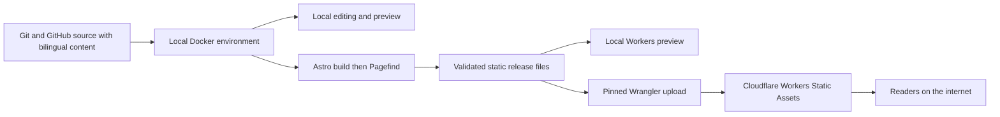

# Docker and Cloudflare Workers Free: hosting assessment

Assessed 13 October 2026. Hosting assessed in revision 2; source workflow aligned with revision 3. **Verdict: viable for the proposed portfolio using Workers Static Assets and a fully generated Astro site.** This is a documentation-based feasibility assessment, not a successful build, deployment, or audit of the owner's Cloudflare account.

The owner has selected Docker for local execution and Cloudflare Workers Free for internet hosting. Projects, writing, English/Bahasa Indonesia, and Navfolio's overall visual style remain the product goals. This document makes those deployment constraints concrete within the [SWEBOK-informed plan](./analysis-and-plan.md).

## 1. What the free tier actually covers

The linked [Cloudflare plans overview](https://www.cloudflare.com/plans/) covers several products. A Free website plan and Workers Free are different product dimensions; a website plan alone does not establish the account's Workers subscription or remaining usage. This assessment uses the Workers-specific documentation and the owner's statement that Workers Free is in use.

| Relevant allowance                        | Current published value                                                      | Consequence for this project                                                                                    |
| ----------------------------------------- | ---------------------------------------------------------------------------- | --------------------------------------------------------------------------------------------------------------- |
| Requests served directly as static assets | Free and unlimited; no additional asset-storage charge                       | HTML, CSS, JavaScript, images, fonts, feeds, and search files can use this path                                 |
| Static assets per Worker version on Free  | 20,000 files                                                                 | Count the final upload set, including bilingual pages, generated images, and Pagefind fragments                 |
| Individual static asset                   | 25 MiB = 26,214,400 bytes                                                    | Optimize or omit oversized files; a large downloadable attachment needs its own decision                        |
| Requests invoking Worker code on Free     | 100,000 per day across the account; resets at midnight UTC                   | Relevant if a future API or server-rendered feature is added; this is not the static site's page-view allowance |
| Worker code CPU time on Free              | 10 ms per HTTP request                                                       | Does not constrain the local Astro build or browser-side search                                                 |
| Optional Workers Builds                   | 3,000 build minutes/month; one concurrent build; 20-minute timeout per build | Not used by the proposed local Docker build and direct upload workflow                                          |

Sources: [Static Assets billing](https://developers.cloudflare.com/workers/static-assets/billing-and-limitations/), [Workers platform limits](https://developers.cloudflare.com/workers/platform/limits/), and [Workers Builds limits and pricing](https://developers.cloudflare.com/workers/ci-cd/builds/limits-and-pricing/). Limits can change; recheck before first release and on a material hosting change.

**Cost conclusion:** the selected architecture can have $0 Cloudflare hosting cost under these published terms. A domain registration/renewal, optional services, and the owner's local computing costs are separate. This does not guarantee that an existing account has no other billable products or usage. No paid add-ons are needed by the planned feature set.

## 2. Fit against the portfolio requirements

| Portfolio capability                                   | Planned execution                                               | Fit / condition                                                           |
| ------------------------------------------------------ | --------------------------------------------------------------- | ------------------------------------------------------------------------- |
| Home, About, projects, articles, archives and taxonomy | Astro renders HTML during the local build                       | Suitable; no server rendering required                                    |
| English and Bahasa Indonesia                           | Generate both route trees and metadata                          | Suitable; raises file count, not runtime compute requirements             |
| Pagefind search                                        | Build indexes after rendering; browser loads static index files | Suitable; no search API or database                                       |
| RSS, sitemap, canonical and alternate URLs             | Generate files using the selected production origin             | Suitable; update only with a new build/deployment                         |
| Theme, menu, table of contents and translation links   | HTML/CSS and browser JavaScript                                 | Suitable; these interactions need no server process                       |
| Responsive images and fonts                            | Prepare assets during build                                     | Suitable; measure final files and avoid requiring a runtime image service |
| Draft/future-date rules                                | Shared publication filter before output and indexing            | Suitable; future dates do not publish themselves without another build    |
| Contact                                                | Ordinary public links or an email link if supplied              | Suitable; a form-processing endpoint is a separate future feature         |

This fit is an engineering inference from the audited Navfolio architecture and the proposed requirements. It does not resolve the existing Indonesian locale, injected-route, font-pipeline, or personal-content issues. G1/G2 still have to prove those changes work.

## 3. Deployment architecture



Docker supplies the local development/build environment. Cloudflare receives the generated files in `dist`. There is no container image or persistent Node server to run in production. Cloudflare documents this fully static Astro deployment with an assets directory and no Worker entry point; the Astro Cloudflare adapter is unnecessary for that mode. See [Cloudflare's static Astro configuration](https://developers.cloudflare.com/workers/framework-guides/web-apps/astro/).

Proposed configuration shape, for later implementation and validation:

```jsonc
{
  "$schema": "./node_modules/wrangler/config-schema.json",
  "name": "portfolio-name-to-confirm",
  "compatibility_date": "2026-10-13",
  "assets": {
    "directory": "./dist",
    "not_found_handling": "404-page",
    "html_handling": "auto-trailing-slash",
  },
}
```

The name is a placeholder; choose and record the compatibility date at implementation, then change it deliberately. Write the configuration explicitly before deployment. Keep `main`, server rendering, and `run_worker_first` out of the initial design. This makes serving assets independent of Worker invocation quotas. Routing requests through a Worker first would change that behavior. See [asset configuration](https://developers.cloudflare.com/workers/static-assets/binding/) and [billing behavior](https://developers.cloudflare.com/workers/static-assets/billing-and-limitations/).

## 4. Local Docker workflow to implement

Local inspection found Docker CLI **29.8.2** and Docker Compose **5.5.1** available. The engine, image pulls, container startup, file watching, and application build have not been exercised. No installation is currently justified merely from the CLI check.

| Local task      | Proposed implementation                                                                                                                                | Acceptance evidence                                                                                    |
| --------------- | ------------------------------------------------------------------------------------------------------------------------------------------------------ | ------------------------------------------------------------------------------------------------------ |
| Develop         | Compose service runs Astro with source mounted and hot reload; listen on the container interface and publish only to host loopback, proposed port 4321 | Edit a real EN/ID content fixture and see the change; restart without losing source                    |
| Build           | Isolated Docker build stage uses pinned Node/Bun, dependency lock and publication-date input; runs validation, Astro, then Pagefind                    | A clean checkout produces the expected full route/content/index set                                    |
| Preview release | A separate service uses pinned Wrangler's local development mode with the generated artifact, proposed loopback port 8787                              | Redirects, status codes, feeds, search, headers and deep links work using the deployment configuration |
| Publish later   | A distinct, explicit Wrangler deployment step uploads the reviewed files using runtime credentials                                                     | Recorded target account/name, origin, deployment identity and hosted smoke results                     |

Planned files are `Dockerfile`, `compose.yaml`, `.dockerignore`, `wrangler.jsonc`, and the publishing guide inside the future portfolio repository. They have not been created in this planning task. Development startup must never trigger publishing.

Use a supported Node version meeting the audited Astro requirement of ≥22.12, record the exact Node/Bun/Wrangler versions, and pin the base image digest. Start with a Debian-based image as a compatibility proposal; validate native dependencies and the actual machine architecture at G1. Keep Linux dependencies in a container-managed location rather than sharing host-installed `node_modules`. Include Git/CA support for the audited Git dependencies. Retain Python/FontTools/Brotli only while the upstream font pipeline actually needs them; remove the pipeline coherently in B16.

Keep the build context limited to the portfolio. Exclude local credentials, `.env` secrets, dependency caches, research documents, the supplied book, and unrelated workspace files. Do not exclude the Markdown content needed by the site. Export build results to an owner-readable directory. Keep release manifests and test evidence outside the publicly served `dist` unless intentionally public. Docker's [build guidance](https://docs.docker.com/build/building/best-practices/) supports staged builds, narrow contexts and deliberate base-image pinning; the exact service split above is this project's design proposal.

## 5. URLs, headers, and publication behavior

- **Origin and base:** deploy at a `workers.dev` origin or the owner's custom domain, with root base `/`. Keep content routes under `/en/` and `/id/`. Repository-subpath hosting is no longer a launch target.
- **Root language:** English remains a proposal. If retained, use a native `_redirects` rule such as `/ /en/ 302`, while providing an Indonesian link on the destination. Confirm the desired default at G2. Do not add a language-detection Worker merely for this redirect. [Redirect documentation](https://developers.cloudflare.com/workers/static-assets/redirects/).
- **Missing pages:** generate a root `404.html` and suitable localized error pages. Test `/en/missing`, `/id/missing`, and a root-level unknown path for an actual 404. Align Astro directory/index output with the HTML handling policy; avoid returning the homepage with 200 for unknown paths. [Static-site routing](https://developers.cloudflare.com/workers/static-assets/routing/static-site-generation/).
- **Headers and caching:** copy reviewed `_headers` and `_redirects` control files into the final asset directory. Apply a content-security policy compatible with the site's actual scripts; check deployed behavior. Keep mutable HTML, feeds and search entry files revalidated, and use long immutable caching only for genuinely fingerprinted assets. [Static asset headers](https://developers.cloudflare.com/workers/static-assets/headers/).
- **Domain:** a `workers.dev` address permits launch without buying a domain. Cloudflare describes it as suitable for personal/hobby use and recommends a custom domain/route for production applications. A custom domain is a branding choice still to resolve, not a prerequisite to prove this portfolio. [Domain guidance](https://developers.cloudflare.com/workers/configuration/routing/workers-dev/).
- **Preview exposure:** use local preview first. Remote preview and production publication are later scoped actions. A publicly accessible preview may expose its contents even when marked `noindex`; exclude private drafts and choose access deliberately.

## 6. Release checks and recovery

Extend existing T01, T04, T15, T16, T18 and T19 rather than creating a parallel quality process:

1. Prove clean Docker startup/build without host Node/Bun dependencies or deploy credentials. Record image identity, platform, tools, source/content pins, origin and build date.
2. Inventory the actual upload set after all image/search generation and exclusions. Fail above the published file-count or per-file cap. Record maximum bytes and total files. Proposed early warnings at 16,000 files or any file over 20 MiB are project headroom targets, not Cloudflare limits. The previous audit's approximate font sizes do not establish a limit violation; measure bytes.
3. Check the explicit static-only configuration, both languages, public-content exclusions, native redirects, correct 404s, headers, RSS and Pagefind in the local Workers preview. Passing local preview does not prove cloud quotas or account readiness.
4. Before a later authorized upload, verify the actual Workers plan, target account/project, domain ownership where applicable, and enabled billable services. Keep credentials out of images, source and generated output. Use a scoped deploy credential supplied only to the deployment process, or the supported interactive authentication flow.
5. Freeze the artifact with checksums and deployment configuration; deploy it without another content build. After upload, record version/deployment identity and test hosted URLs, search, feeds, metadata and caching. Retain the previous artifact and matching configuration. Never describe an untested upload as accepted.
6. Rehearse recovery by redeploying the saved known-good artifact/configuration; this does not depend on a moving source branch. For first launch, retain an intentionally prepared minimal holding artifact. Test the existing 30-minute recovery objective; it is a proposed drill target, not a hosting guarantee.

If files outgrow the allowance, first remove accidental demo output, unused fonts/media and redundant generated variants, then remeasure. If the desired content still cannot fit, present a concrete scope/storage/plan decision; do not silently enable a paid service. Any future SSR, forms, authentication, comments, analytics, database, image API or scheduled build requires a new capacity/cost review.

## 7. Plan impact and remaining uncertainty

Confirmed constraints are UG04 (Docker locally), UG05 (Workers Free) and UG06 (Git/GitHub). Source publication follows master-plan §11.1 / ADR10; pushing source does not automatically deploy the website. GitHub owner/repository name is still to resolve. The hosting assessment itself is unchanged. ADR07 now selects the asset-only deployment path; ADR09 defines local execution. R20 and R22 carry acceptance contracts, B02/B19 carry implementation work, and existing tests/risks carry the evidence. This follows SWEBOK's requirements, architecture, configuration, operations, quality and engineering-economics treatment without claiming the book mandates a particular vendor or tool.

Allow **2–4 additional focused hours** in the baseline phase for Docker setup and local Workers preview verification. Workers deployment replaces the previously estimated generic hosting work. The revised remaining base estimate is **42–68 hours**, plus **9–14 hours** of planning allowance, giving **51–82 hours**. These remain judgment estimates; repeat them after G1/G2 evidence. No fixed calendar deadline has been supplied.

What remains unproven: a successful containerized Navfolio build, final output file count/size, bilingual behavior, the account's actual subscription/usage, the chosen domain, and hosted acceptance. Those are execution checkpoints. None changes the present conclusion that the planned static portfolio is a good architectural fit for Workers Free.
